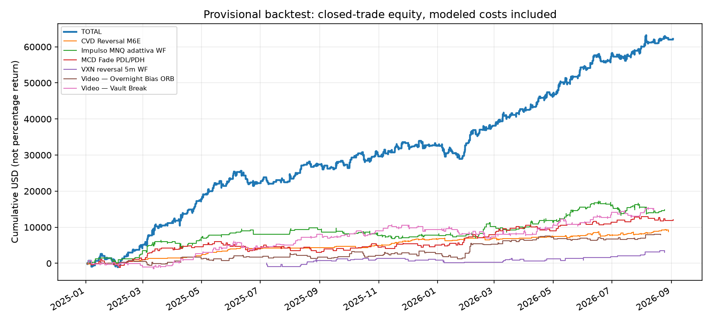

# Systematic futures research portfolio

Recruiter-facing index and reproducible portfolio analytics for a personal systematic futures research program.

## Explore the projects
- [Volatility prediction and confidence/coverage](https://github.com/D3niel93/intraday-volatility-regime-research)
- [Causal adaptive exit selection](https://github.com/D3niel93/adaptive-futures-exit-research)
- [Event ordering and backtest validation](https://github.com/D3niel93/event-driven-backtesting-lab)
- [Native C# signal and demo execution architecture](https://github.com/D3niel93/quantower-strategy-engine)

## Portfolio scope
| Strategy | Research market | Role |
|---|---|---|
| CVD reversal | M6E | Order-flow reversal |
| Adaptive impulse | MNQ | Momentum continuation |
| CAD PDL/PDH fade | MCD (micro CAD) | Prior-day levels |
| VXN reversal, 5m walk-forward | MNQ | Forecast-band mean reversion |
| Vault break | MNQ | Breakout |
| Overnight bias ORB | MNQ | Overnight-conditioned opening breakout |

**MCD means micro CAD, not McDonald's.** The Quantower demo port uses standard 6C with different tick value/contract sizing; research dollars must not be copied across instruments. M6E fade and VWAP pullback variants were removed. Vault and Overnight are independent interpretations of an externally discussed strategy: [source video](https://www.youtube.com/watch?v=A0G14JYYVTk). No ownership of that underlying idea is claimed.

## Reproduce the published ledger analysis
```bash
python -m pip install -r requirements.txt
python report.py
python -m unittest discover -s tests -v
```
The published ledger is filtered to exclude VWAP pullback. The script rebuilds aggregate and per-strategy WR, PF, expectancy, daily Sharpe, trade-equity DD, monthly PnL and daily correlations, with plots. Dates and all metrics come from the actual ledger, not a manually written CV table. PnL is USD, with modeled costs already embedded: $1 round trip per contract. Do not subtract the same cost twice.

## Risk and interpretation
Reference capital $50,000; fixed maximum planned setup risk $500 (1% reference capital), not compounding. Multi-level same-setup legs split the budget. Whole contracts and actual stop gaps can prevent exact 1% sizing. Realized/closed-trade DD is not intratrade mark-to-market DD. Sharpe uses observed business-day PnL with zero-filled weekdays and sqrt(252), distinct from older sqrt(365) calendar reports.

Historical strategies were combined as independent sleeves. The native adapter gates concurrent entries on the same account/instrument, so the historical aggregate is **not** a demo/live execution forecast. Correlation is sample-dependent and low correlation does not establish independence. Available 2026 is partial; no live audited record or guaranteed return is claimed.

## Evidence, not performance promises


The selected ledger has 1,549 rows, net modeled PnL $62,213, PF 1.373, WR 71.01%, mean $40.16/row and closed-trade DD $5,007. These are provisional research outputs over 2025-01-02–2026-09-02, with unequal sleeve coverage, not a live track record. Inspect [recomputed summary](reports/summary.csv), [year split](reports/by_year.csv), [monthly output](reports/monthly.csv), [correlations](reports/daily_correlation.csv) and [recruiter notes](docs/recruiter_notes.md).

See [data provenance and limitations](docs/provenance.md). Results are backtests, not audited live returns. The public runnable commands reproduce derived-output analytics or synthetic checks, not the entire licensed-data research process.
